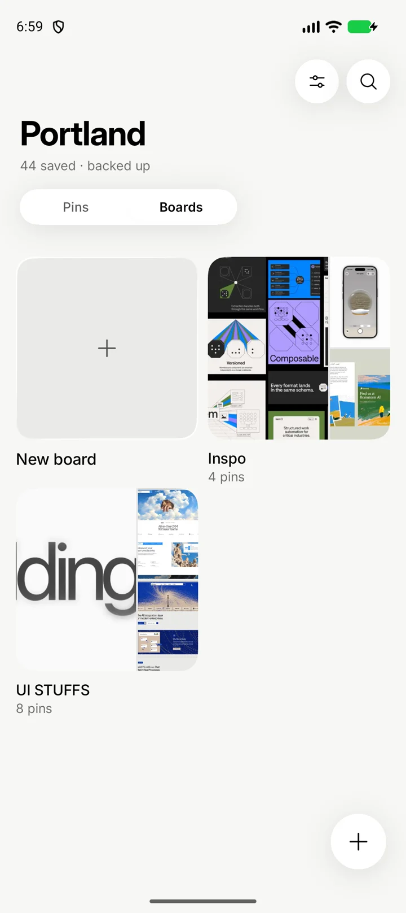

<p align="left">
  
</p>

# Portland

A self-hosted, native Android Pinterest alternative built in Kotlin. Save images and videos, organize them into boards, and find anything by note, colour, or AI description — no accounts, no tracking.

Inspired by Apple's **Liquid Glass** aesthetic, Portland is designed to feel ultra-lightweight with fluid, zero-jank gestures and smooth animations across scrolling, search, the `+` action panel, and the gallery viewer.

<p align="center">
  
  
  
  
</p>
<p align="center">
  <em>Masonry Feed &nbsp;&bull;&nbsp; Boards &nbsp;&bull;&nbsp; Gallery Viewer &nbsp;&bull;&nbsp; Colour &amp; AI Search</em>
</p>

## Smooth Gestures & Motion

<p align="center">
  
</p>
<p align="center">
  <em>Feed scrolling &nbsp;&bull;&nbsp; Morphing + panel &nbsp;&bull;&nbsp; Instant search &nbsp;&bull;&nbsp; Gallery swipe &amp; pull-to-dismiss</em>
</p>

## Features

- **Masonry Feed & Boards** — Swipe between Pins and Boards, or long-press to batch-select, organize, and delete.
- **Save from Anywhere** — Pick from your gallery, paste a link, or share directly to Portland. Background workers download images and videos (up to 1080p) using on-device `yt-dlp`. Share an X post or Pinterest pin with several photos or videos and every one of them is saved, downloading in parallel.
- **Smart Search** — Search instantly by notes, board names, 12 colour buckets (e.g. `"blue"`), or background AI descriptions.
- **Gallery Viewer** — Scrub through pins on a filmstrip, pinch-to-zoom right in the viewer (photos carry on into full-screen zoom), double-tap to seek videos, pull down to fly back to the grid, or pull up to share and export.
- **Self-Hosted Sync** — Backs up your library to your own Cloudflare R2 bucket and restores everything on a fresh install. Works fully offline without credentials.
- **Auto-Updates** — Checks for new signed releases in the background and prompts to restart when an update is ready.

## Setup

Add your Cloudflare credentials to `local.properties` (git-ignored). Without them, Portland runs offline in local-only mode.

```properties
r2.accountId=<cloudflare account id>
r2.bucket=portland
r2.accessKey=<R2 access key id>
r2.secretKey=<R2 secret access key>
ai.token=<API token with Workers AI read/write>
```

> **Tip:** One Cloudflare API token with *Workers AI Read/Write* and *R2 Bucket Item Read/Write* (`portland`) covers both — `r2.accessKey` is the token ID and `r2.secretKey` is the SHA-256 hash of the token value.

## Build

```sh
./gradlew :app:testDebugUnitTest                 # Run unit tests
./gradlew :app:assembleRelease                   # Build signed release APK (arm64-v8a)
./gradlew :app:assembleRelease -Pabis=x86_64     # Build release APK for x86_64 emulators
```

## Tech Stack

- **Kotlin & Jetpack Compose** — Native Android UI with Inter typography, Phosphor icons, Liquid Glass surfaces, and zero-recomposition gesture handling (`ui/Gestures.kt`).
- **Offline-First Storage** — Atomic `library.json` state (`data/Store.kt`) with WorkManager-backed R2 sync (`data/Sync.kt`, `data/R2.kt`).
- **Media & AI** — On-device `yt-dlp` + `ffmpeg` (`data/Video.kt`), HSV colour indexing (`data/Colors.kt`), and Workers AI vision captions (`data/Captions.kt`).
