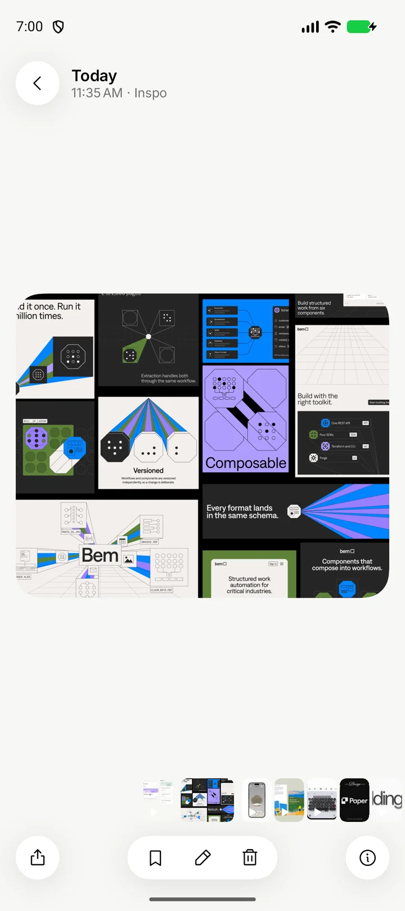
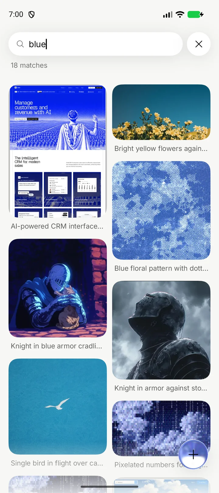
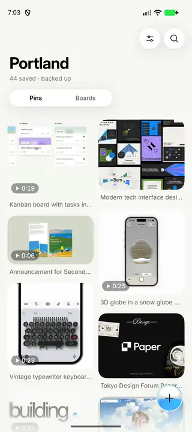

<div align="center">


# Portland

**A self-hosted, on-device Pinterest alternative for Android.**<br>
Save images and videos, sort them into boards, and find anything by note, colour or AI description.<br>
No accounts, no tracking.

[](https://github.com/GitNimay/portland/actions/workflows/android.yml)
[](https://github.com/GitNimay/portland/releases/latest)


[](LICENSE)





<sub>Feed · Boards · Viewer · Search</sub>

</div>

## Features

- **Masonry feed and boards.** Swipe between Pins and Boards, pinch the grid to 2, 3 or 4 columns, and long-press to select in bulk.
- **Save from anywhere.** Pick from the gallery, paste a link, or share to Portland. On-device `yt-dlp` downloads images and videos (up to 1080p), including every photo and video in a multi-media X post or Pinterest pin.
- **Search by anything.** Notes, board names, 12 colour buckets (try `blue`), or AI-written descriptions.
- **Gallery viewer.** Filmstrip scrubbing, pinch-to-zoom, double-tap to seek videos, pull down to dismiss, pull up to share.
- **Your own cloud.** Optional backup and restore to your own Cloudflare R2 bucket. Works fully offline without it.
- **Self-updating.** Signed releases install in the background; restart when one is ready.

<div align="center">
  
  <br><sub>Liquid Glass surfaces and zero-jank gestures throughout</sub>
</div>

## Install

Download the latest APK from [**Releases**](https://github.com/GitNimay/portland/releases/latest). Release builds target `arm64-v8a` phones; after the first install, updates arrive automatically.

## Build

Requires JDK 21 and the Android SDK.

```sh
./gradlew :app:assembleDebug                      # debug APK
./gradlew :app:testDebugUnitTest :app:lintDebug   # tests and lint
./gradlew :app:assembleRelease -Pabis=x86_64      # release APK for an x86_64 emulator
```

<details>
<summary><b>Cloud sync and AI search (optional)</b></summary>

<br>

Add your Cloudflare credentials to `local.properties` (git-ignored). Without them Portland runs in local-only mode.

```properties
r2.accountId=<cloudflare account id>
r2.bucket=portland
r2.accessKey=<R2 access key id>
r2.secretKey=<R2 secret access key>
ai.token=<API token with Workers AI read/write>
```

One Cloudflare API token with *Workers AI Read/Write* and *R2 Bucket Item Read/Write* covers both. `r2.accessKey` is the token ID and `r2.secretKey` is the SHA-256 hash of the token value.

</details>

## Project structure

```
app/src/main/java/app/portland/
├── data/    storage, R2 sync, downloads, colour index, AI captions, updater
└── ui/      Compose screens, gestures, Liquid Glass surfaces, theme
app/src/test/          JVM unit tests
baselineprofile/       baseline profile generator (startup and scroll performance)
.github/               CI, release publishing, security scanning
```

Built with Kotlin and Jetpack Compose, WorkManager, Media3, Coil, OkHttp, `yt-dlp` and `ffmpeg`, Inter typography and Phosphor icons.

## License

[MIT](LICENSE)
