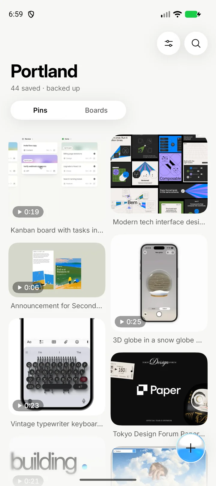

<div align="center">


# Portland

**A self-hosted, on-device Pinterest alternative for Android.**<br>
Save images and videos, sort them into boards, and find anything by note, colour or AI description.<br>
No accounts, no tracking.

[](https://github.com/GitNimay/portland/actions/workflows/android.yml)
[](https://github.com/GitNimay/portland/releases/latest)


[](LICENSE)




<sub>Feed · Boards · Viewer · Search</sub>

</div>

## Features

- **Masonry feed and boards.** Swipe between Pins and Boards, pinch the grid to 2, 3 or 4 columns, and long-press to select in bulk.
- **Save from anywhere.** Pick from the gallery, paste a link, or share to Portland. On-device `yt-dlp` downloads images and videos (up to 1080p), including every photo and video in a multi-media X post or Pinterest pin.
- **Search by anything.** Notes, board names, 12 colour buckets (try `blue`), or AI-written descriptions.
- **Gallery viewer.** Filmstrip scrubbing, pinch-to-zoom, double-tap to seek videos, pull down to dismiss, pull up to share.
- **Your own cloud.** Keep pins on your phone, or connect your own Cloudflare R2 bucket by pasting one token: store everything there, or use it as a backup.
- **Self-updating.** Signed releases install in the background; restart when one is ready.

<div align="center">
  
  <br><sub>Liquid Glass surfaces and zero-jank gestures throughout</sub>
</div>

## Install

Download the latest APK from [**Releases**](https://github.com/GitNimay/portland/releases/latest). Release builds target `arm64-v8a` phones; after the first install, updates arrive automatically.

The app checks the latest GitHub release for an update (`latest.json` sits next to the APK), downloads it in the background and verifies its SHA-256 before offering a restart. Builds from before bring-your-own-R2 (their built-in key is revoked) need the new APK installed once by hand; it installs over them and keeps what is saved on the phone.

## Build

Requires JDK 21 and the Android SDK.

```sh
./gradlew :app:assembleDebug                      # debug APK
./gradlew :app:testDebugUnitTest :app:lintDebug   # tests and lint
./gradlew :app:assembleRelease -Pabis=x86_64      # release APK for an x86_64 emulator
```

<details>
<summary><b>Cloud storage and AI search (optional)</b></summary>

<br>

No keys are built into the app. Each person connects their own Cloudflare R2 bucket in **Settings → Storage → Cloudflare R2**:

1. Tap **Create token on Cloudflare**. Cloudflare opens a new account API token (owned by the account, not a person) with Portland's permissions already filled in (*Workers R2 Storage Edit*, *Account Settings Read*, *Workers AI Read*). Press **Create** and copy the token.
2. Paste it into Portland and tap **Connect**. Portland finds the account, creates a `portland-library` bucket and checks that it can write there. The S3 keys come from the token itself: the access key ID is the token ID and the secret is the SHA-256 of the token value.

R2 has to be turned on in the Cloudflare dashboard once (it has a free tier). People who already have R2 access keys can tap **Use access keys instead**.

- **Keep copies on this phone** off (the default): R2 is where pins live. Each pin uploads, then its phone copy is removed and streams back when opened. Thumbnails stay on the phone.
- **Keep copies on this phone** on: a backup. Every pin stays on the phone and a copy goes to R2.
- **This phone**: downloads anything that is only in R2, then stops using it. The bucket is left as it is.

The keys are sealed with an Android Keystore key and are never backed up. AI descriptions run on Workers AI in the same account when the token allows it.

To test against a real bucket: `PORTLAND_CF_TOKEN=<token> PORTLAND_CF_ACCOUNT=<account id> ./gradlew :app:testDebugUnitTest --tests '*R2LiveTest*'`.

</details>

## Project structure

```
app/src/main/java/app/portland/
├── data/    storage, R2 connect and sync, downloads, colour index, AI captions, updater
└── ui/      Compose screens, gestures, Liquid Glass surfaces, theme
app/src/test/          JVM unit tests
baselineprofile/       baseline profile generator (startup and scroll performance)
.github/               CI, release publishing, security scanning
```

Built with Kotlin and Jetpack Compose, WorkManager, Media3, Coil, OkHttp, `yt-dlp` and `ffmpeg`, Inter typography and Phosphor icons.

## License

[MIT](LICENSE)
